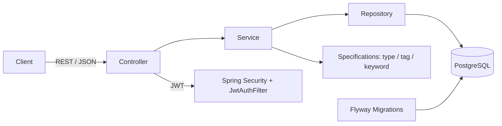

# DevelopersHub

> One searchable place for the opportunities student developers usually hunt across a dozen sites.


Hackathons, internships, GSoC-style programs, and beginner-friendly open-source issues — scattered, easy to miss, hard to save. **DevelopersHub** pulls them into one filterable, personal catalog.

Built as a real tool and as a hands-on backend. **v0.1 is done:** full CRUD, JWT auth, role-based access, tagging, search, bookmarks, and CI. Hand-built and verified end to end.

**Shipped:** backend core · **Next:** web UI, deployment

## Features

**Discover**
- Paginated opportunity list with total count and page metadata
- Combined filters for type, tag, and keyword (Spring Data JPA Specifications)
- Case-insensitive keyword search across title and organization
- Single-opportunity detail

**Curate**
- Create, update, and delete opportunities, with validation and correct HTTP status codes
- Many-to-many tags through a normalized join table
- Writes locked to admins

**Personal**
- Register and log in; passwords hashed with BCrypt; stateless JWT
- Bookmark and unbookmark
- Personal saved list, sorted by deadline

**Engineering**
- Versioned schema migrations with Flyway
- PostgreSQL in Docker Compose for local dev
- Tests on every pull request via GitHub Actions

## Architecture



Layered Spring Boot app: **Controller → Service → Repository**. Filters are composable JPA Specifications. Auth is stateless JWT.

## Tech stack

| Layer | Technology |
| --- | --- |
| Language | Java 25 |
| Framework | Spring Boot 4.1.1 |
| Data access | Spring Data JPA (Hibernate) |
| Auth | Spring Security + JJWT |
| Database | PostgreSQL 16 |
| Migrations | Flyway |
| Build | Maven |
| Local dev | Docker Compose |
| CI | GitHub Actions |

## API

Base URL once the app is running: `http://localhost:8080`

### Opportunities — `/api/opportunities`

| Method | Endpoint | Auth |
| --- | --- | --- |
| `GET` | `/` | Public. Filter with `type`, `tag`, `keyword`. Paginated. |
| `GET` | `/{id}` | Public |
| `POST` | `/` | Admin |
| `PUT` | `/{id}` | Admin |
| `DELETE` | `/{id}` | Admin |

```http
GET /api/opportunities?type=program&tag=beginner-friendly&keyword=google&page=0&size=10
```

### Auth — `/api/auth`

| Method | Endpoint | What it does |
| --- | --- | --- |
| `POST` | `/register` | Create an account. Returns a JWT. |
| `POST` | `/login` | Returns a fresh JWT. |

### Bookmarks — `/api/bookmarks`

All three require a logged-in user.

| Method | Endpoint | What it does |
| --- | --- | --- |
| `POST` | `/{opportunityId}` | Bookmark an opportunity |
| `DELETE` | `/{opportunityId}` | Remove a bookmark |
| `GET` | `/` | Saved opportunities, sorted by deadline |

## Getting started

**Prerequisites:** Java 25, Docker, Maven (or the included `mvnw` wrapper)

```bash
# 1. Start PostgreSQL
docker compose up -d

# 2. Run the backend
cd backend
./mvnw spring-boot:run
```

API: `http://localhost:8080/api/opportunities`

## Project structure

```text
backend/
├── src/main/java/com/developershub/backend/
│   ├── controller/       # REST endpoints
│   ├── service/          # Business logic
│   ├── repository/       # Spring Data JPA repositories
│   ├── specification/    # Composable query filters
│   ├── security/         # JWT generation, validation, filter
│   ├── config/           # Spring Security + password encoding
│   ├── entity/           # JPA entities
│   └── dto/              # API request/response shapes
└── src/main/resources/db/migration/   # Flyway migrations
```

## Roadmap

Part of a public, year-long software engineering roadmap ([#100DaysOfCode](https://github.com/topics/100daysofcode)). Every feature is hand-built rather than generated — the point is to understand the system, not just ship it.

| | |
| --- | --- |
| **v0.1** | Backend core. Done. |
| **Next** | Frontend (web UI), then deployment. |

## Contributing

Solo project. Work is tracked on GitHub milestones and issues. Suggestions are welcome.

## License

[MIT](LICENSE)
