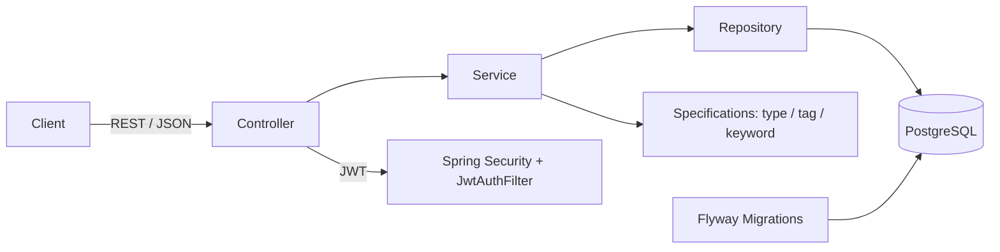

# DevelopersHub

> A developer-focused platform for discovering resources, projects, tools, and opportunities — all in one place.

## About

Student developers juggle hackathons, internships, GSoC-style programs, and beginner-friendly open-source issues scattered across a dozen different sites. DevelopersHub brings them into one searchable, filterable, personal place — built both as a real tool and as a hands-on backend learning project.

**v0.1 backend core is complete** — full CRUD, auth, role-based access, tagging, search, bookmarking, and CI, all hand-built and verified end-to-end.

## Features

- Full CRUD for opportunities (create, read, update, delete) with validation and correct HTTP status codes
- Paginated listing with total count and page metadata
- Many-to-many tagging (opportunities ↔ tags) through a normalized join table
- Combined filtering by type, tag, and keyword, built with Spring Data JPA Specifications
- Case-insensitive keyword search across title and organization
- User registration and login with JWT authentication (BCrypt password hashing)
- Role-based access control — only admins can create, edit, or delete opportunities
- Bookmark / unbookmark opportunities, with a personal saved list sorted by deadline
- Versioned schema migrations with Flyway
- Dockerized PostgreSQL for local development
- Continuous integration — tests run automatically on every pull request

### Planned next
- Frontend (web UI)
- Deployment

## Architecture

A layered Spring Boot backend — **Controller → Service → Repository** — with dynamic filtering through composable JPA Specifications and stateless JWT-based authentication.

## Tech Stack

| Layer | Technology |
|---|---|
| Language | Java 25 |
| Framework | Spring Boot 4.1.1 |
| Data access | Spring Data JPA (Hibernate) |
| Auth | Spring Security + JJWT |
| Database | PostgreSQL 16 |
| Migrations | Flyway |
| Build tool | Maven |
| Local dev | Docker Compose |
| CI | GitHub Actions |

## API Overview

**Opportunities** — `/api/opportunities`

| Method | Endpoint | Auth required |
|---|---|---|
| `GET` | `/` | No — filterable by `type`, `tag`, `keyword`, paginated |
| `GET` | `/{id}` | No |
| `POST` | `/` | Admin |
| `PUT` | `/{id}` | Admin |
| `DELETE` | `/{id}` | Admin |

**Auth** — `/api/auth`

| Method | Endpoint | Description |
|---|---|---|
| `POST` | `/register` | Create an account, returns a JWT |
| `POST` | `/login` | Returns a fresh JWT |

**Bookmarks** — `/api/bookmarks` (all require a logged-in user)

| Method | Endpoint | Description |
|---|---|---|
| `POST` | `/{opportunityId}` | Bookmark an opportunity |
| `DELETE` | `/{opportunityId}` | Remove a bookmark |
| `GET` | `/` | My saved opportunities, sorted by deadline |

Example:
